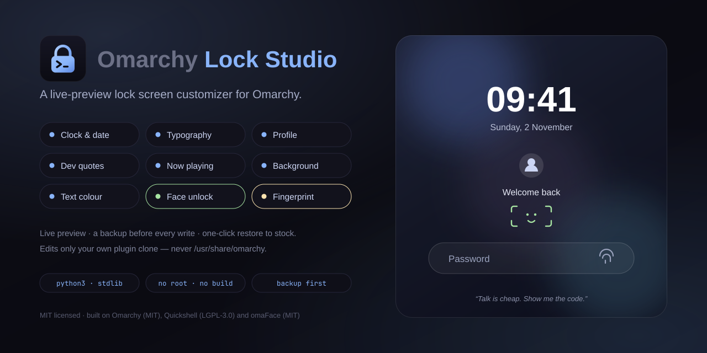

<div align="center">


# Omarchy Lock Studio

**A live-preview customizer for the [Omarchy](https://github.com/basecamp/omarchy) lock screen.**
Change the clock, fonts, welcome line, quotes, now-playing art and background —
watch it update instantly, and never lose the password field.

[](LICENSE)




</div>

## What it is

A small local web app on `127.0.0.1:8731`. It edits **your own clone** of the
Omarchy lock plugin and regenerates `LockView.qml` — always keeping the password
field, the PAM contexts and the ability to unlock intact.

```
python3 + stdlib only   ·   no build step   ·   no root   ·   never touches /usr/share/omarchy
```

## What you can change

| Area | Options |
| --- | --- |
| **Clock** | on/off, time format (`hh:mm AP`, seconds), date format, timezone, size, top/bottom |
| **Typography** | text font for the whole screen, separate clock font, clock weight (regular → black), clock letter spacing |
| **Profile** | name, avatar, hostname, editable welcome line (`{name}` placeholder), any corner |
| **Dev quotes** | 30 built-in quotes, rotation interval, size, top/bottom |
| **MPRIS media** | now-playing title/artist/art, four anchor positions |
| **Background** | pick any image, automatic upscaling, blur, dim |
| **Text color** | theme colors, custom hex, or auto-picked from the background brightness |
| **Authentication** | live status for face unlock ([omaFace](https://github.com/L0adn9/omaface), IR camera) and fingerprint (fprintd) — enroll, test, and toggle each on the lock |
| **Safety** | automatic backup before every write, restore any backup, restore stock |

Fonts are suggested from `fc-list`, so anything installed on your system is
available. The profile name default comes from the account's own full name and
falls back to a plain `Name` placeholder — never someone else's.

## Install

Any Omarchy machine, any user. Nothing in the repo is tied to one hostname or
one account.

```bash
git clone https://github.com/Fiercejojo88862/omarchy-lock-studio.git
cd omarchy-lock-studio
./install.sh
```

That copies the app into `~/.local/bin`, adds a **Settings → Omarchy Lock
Studio** launcher and installs the icon.

Create the plugin clone the app will edit (one time):

```bash
omarchy plugin clone omarchy.lock     # creates ~/.config/omarchy/plugins/<you>.lock and switches to it
```

Then launch:

```bash
omarchy-lock-studio
```

or use the app launcher. The UI opens in your browser; click **Apply & restart**
to write the QML and reload the shell.

> **One lock plugin only.** The Wayland session lock has exactly one owner. If
> another lock plugin is enabled (for example a face-unlock plugin that ships
> its own lock screen), disable it first with
> `omarchy plugin disable <id>` — otherwise the other plugin wins and your
> customized view never renders, with no error in the logs.

## Biometric unlock

Optional, and entirely additive — the password stays the fallback on every
lock.

- **Face** — needs an IR camera and [omaFace](https://github.com/L0adn9/omaface).
  The studio shows whether the camera, the `omaface-lock` PAM service and an
  enrolled appearance are present, and opens a terminal for `omaface enroll` /
  `omaface test` so enrollment is never driven blind.
- **Fingerprint** — needs a reader and `fprintd`. The studio detects the reader
  with `omarchy-hw-fingerprint` and defers the PAM setup to Omarchy's own
  `omarchy-setup-security-fingerprint`.

A machine without the hardware is told plainly rather than offered a switch
that cannot work.

## Command line

```bash
omarchy-lock-studio              # start the server and open the browser
omarchy-lock-studio --no-open    # start the server only
omarchy-lock-studio --restore-stock
```

`--sync-repo` (and the matching web button) copies the app into a checkout of
this project's repo and pushes it. It only appears when `LOCKSTUDIO_REPO`
points at that checkout, so it is invisible on a normal install.

## How it works

1. Finds your cloned lock plugin (`manifest.json` with `omarchy.clonedFrom = omarchy.lock`).
2. Renders `LockView.qml` from an internal template with your settings baked in as QML properties.
3. Backs up the previous `LockView.qml` into `~/.config/omarchy/lockscreen-customizer/backups/`.
4. Writes the file and restarts the shell so the lock screen picks it up.

Settings and backups live in `~/.config/omarchy/lockscreen-customizer/`.
Nothing outside your home directory is modified.

## Safety notes

- The generated view keeps the `submitPassword` / `passwordTextEdited` signals and the PAM contexts untouched, so you can always unlock with your password.
- `Restore stock` writes back the untouched clone; `Restore…` lets you pick any backup.
- If you edit the app while it is running, relaunch it before clicking Apply — a stale server can rewrite a broken `LockView.qml`.
- Biometrics only ever add a way in. Both flows authenticate through their own PAM services (`omaface-lock`, `omarchy-lock-fingerprint`), so the password field and `pam_unix` remain the fallback on every lock — the app never replaces them.

## Credits

Omarchy Lock Studio is a thin layer on top of other people's work. The lock
screen belongs to **Omarchy** (MIT) and **Quickshell** (LGPL-3.0); face unlock
belongs to **omaFace** by L0adn9 (MIT), including the face mark shipped inline
in the generated view; fingerprint support is **fprintd** (GPL-2.0+) and
**libfprint** (LGPL-2.1+) configured by Omarchy's own setup command.

Full accounting, asset licenses and the "not affiliated" note:
**[CREDITS.md](CREDITS.md)**.

## License

MIT — see [LICENSE](LICENSE). The logo and preview artwork are original work
under the same license.
