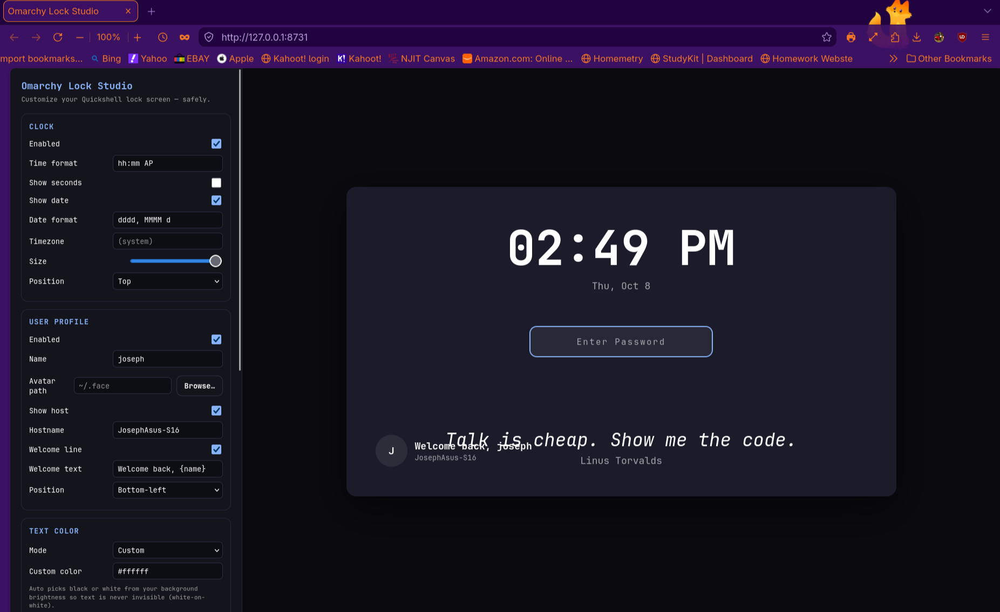

# Omarchy Lock Studio

A safe, live-preview web customizer for the [Omarchy](https://github.com/basecamp/omarchy) lock screen.

Runs a small local web app on `127.0.0.1:8731`, edits **your own clone** of the Omarchy lock plugin, and regenerates `LockView.qml` — always keeping the password field and PAM authentication intact.

```
python3 + stdlib only      no build step      no root      never touches /usr/share/omarchy
```



## What you can change

| Area | Options |
| --- | --- |
| **Clock** | on/off, time format (`hh:mm AP`, seconds), date format, timezone, size, top/bottom |
| **Typography** | text font for the whole screen, separate clock font, clock weight (regular → black), clock letter spacing |
| **Profile** | name, avatar, hostname, editable welcome line (`{name}` placeholder), any corner |
| **Dev quotes** | 30 built-in quotes, rotation interval, size, top/bottom |
| **MPRIS media** | now-playing title/artist/art, four anchor positions |
| **Background** | pick any image, automatic upscaling, blur, dim |
| **Text color** | theme colors, custom hex, or auto-picked from the background brightness |
| **Safety** | automatic backup before every write, restore any backup, restore stock |

Fonts are suggested from `fc-list`, so anything installed on your system is available.

## Requirements

- Omarchy (Quickshell shell) on Arch Linux
- Python 3 (already present on Omarchy)
- A cloned lock plugin to edit — see below

## Install

```bash
git clone https://github.com/Fiercejojo88862/omarchy-lock-studio.git
cd omarchy-lock-studio
./install.sh
```

That copies the app into `~/.local/bin` and adds a **Settings → Omarchy Lock Studio** launcher.

Create the plugin clone the app will edit (one time):

```bash
omarchy plugin clone omarchy.lock     # creates ~/.config/omarchy/plugins/<you>.lock and switches to it
```

Then launch:

```bash
omarchy-lock-studio
```

or use the app launcher. The UI opens in your browser; click **Apply & restart** to write the QML and reload the shell.

> **One lock plugin only.** The Wayland session lock has exactly one owner. If you also run another lock plugin (for example a face-unlock plugin that ships its own lock screen), disable it first with `omarchy plugin disable <id>` — otherwise the other plugin wins and your customized view never renders, with no error in the logs.

## Command line

```bash
omarchy-lock-studio              # start the server and open the browser
omarchy-lock-studio --no-open    # start the server only
omarchy-lock-studio --restore-stock
omarchy-lock-studio --sync-repo  # copy this app into ~/Work/omarchy-lock-studio and push
```

## How it works

1. Finds your cloned lock plugin (`manifest.json` with `omarchy.clonedFrom = omarchy.lock`).
2. Renders `LockView.qml` from an internal template with your settings baked in as QML properties.
3. Backs up the previous `LockView.qml` into `~/.config/omarchy/lockscreen-customizer/backups/`.
4. Writes the file and restarts the shell so the lock screen picks it up.

Settings and backups live in `~/.config/omarchy/lockscreen-customizer/`. Nothing outside your home directory is modified.

## Safety notes

- The generated view keeps the `submitPassword` / `passwordTextEdited` signals and the PAM contexts untouched, so you can always unlock with your password.
- `Restore stock` writes back the untouched clone; `Restore…` lets you pick any backup.
- If you edit the app while it is running, relaunch it before clicking Apply — a stale server can rewrite a broken `LockView.qml`.
- An optional face-unlock indicator is part of the generated view. It stays hidden unless the service side supplies `faceState` / `faceAvailable` (see [omaFace](https://github.com/L0adn9/omaface)); the password always works regardless.

## Related

- Case study: [fiercejojo88862.github.io/Personal-Portfolio-Website/project-lock-studio.html](https://fiercejojo88862.github.io/Personal-Portfolio-Website/project-lock-studio.html)
- Omarchy: https://github.com/basecamp/omarchy

## License

MIT — see [LICENSE](LICENSE).
